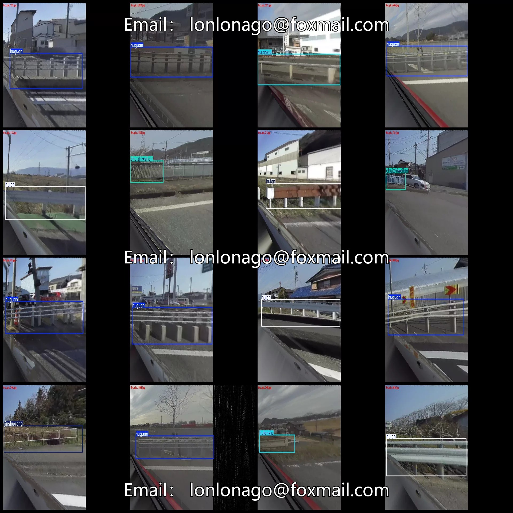
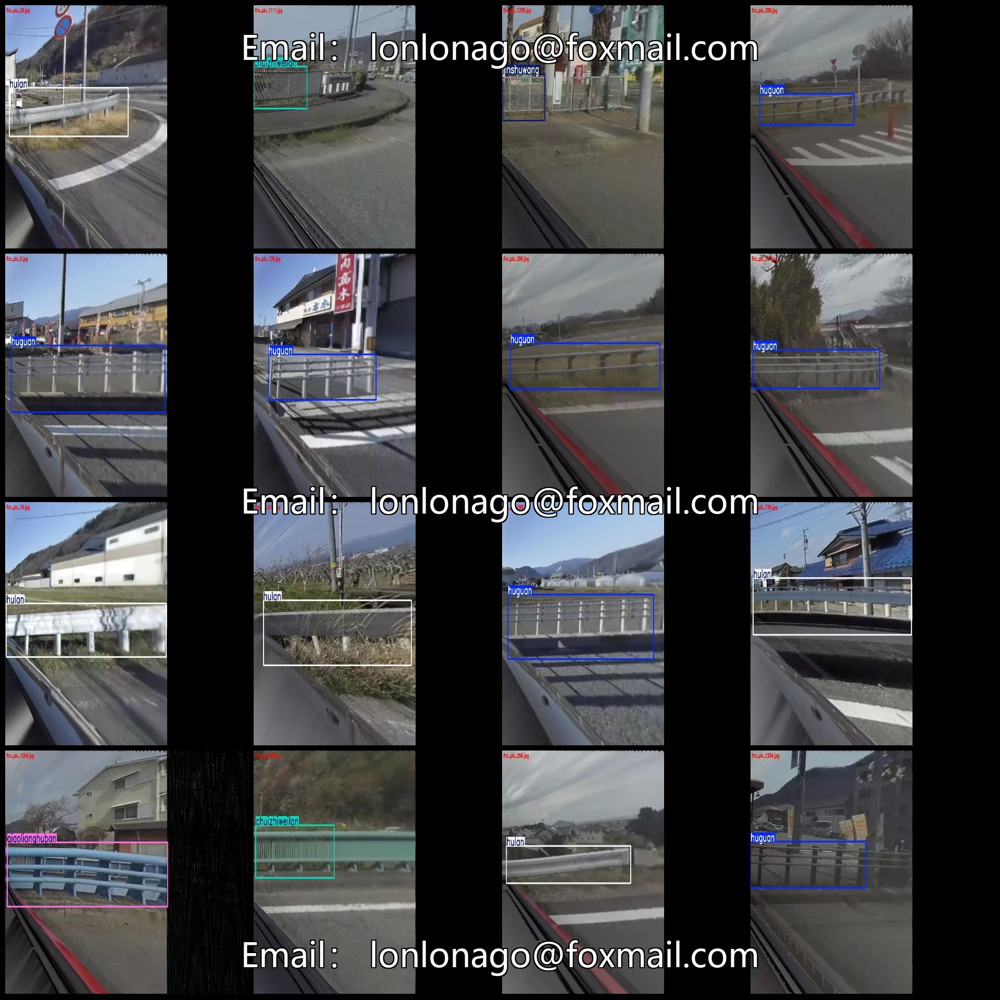
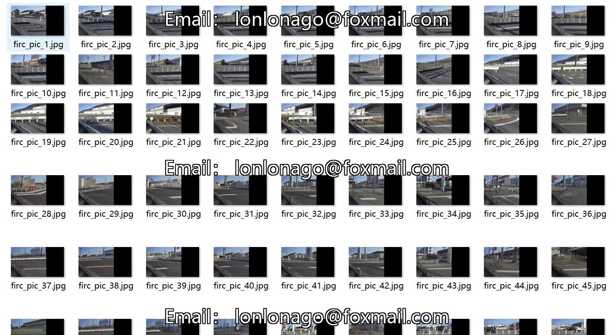
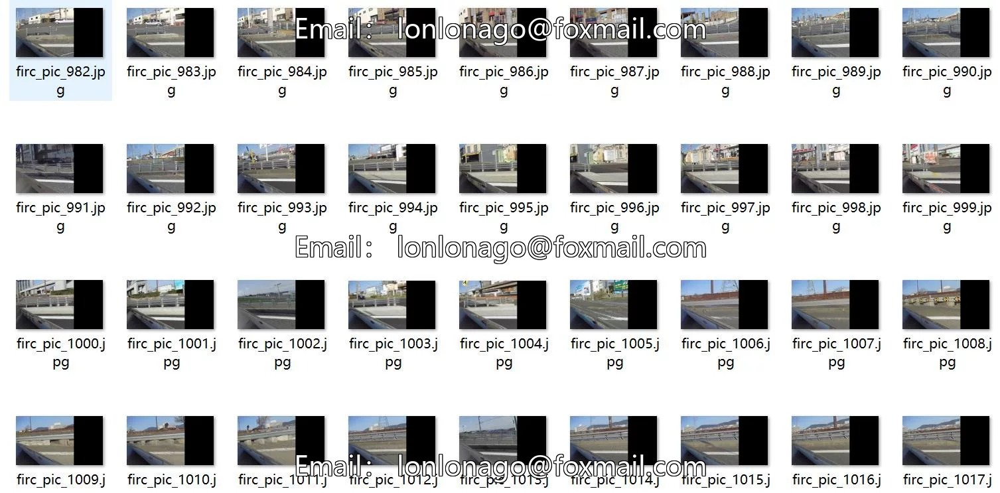
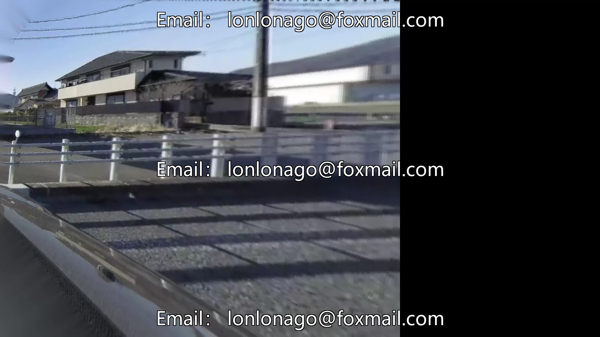
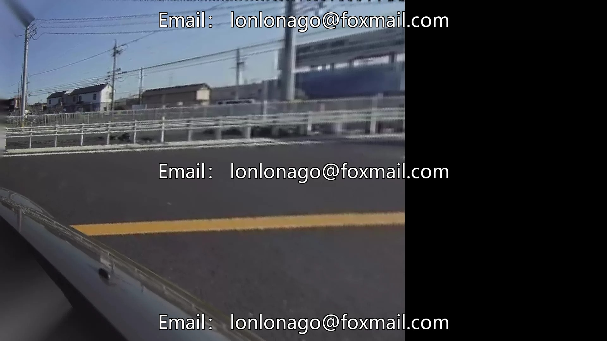
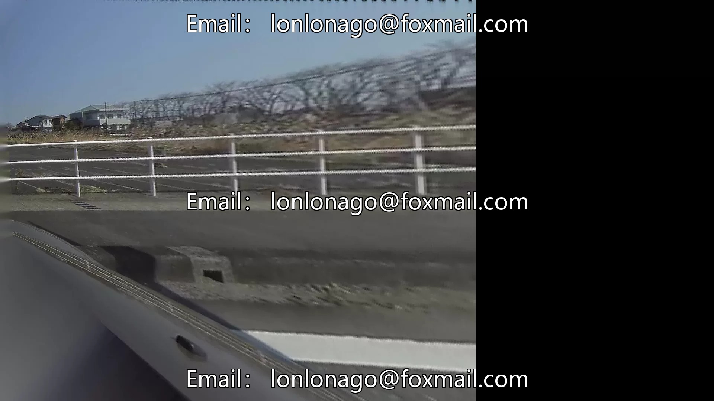

# Road protective barrier detection dataset VOC+YOLO format 1352 images in 6 categories

## Body

Road Protection Fence Detection Dataset VOC+YOLO format: 1352 images in 6 categories
Tips: Due to the dataset's replicability, please confirm compliance before purchasing.
Please note that the overall image quality is not very clear; individual images can be viewed for details.
Dataset format: Pascal VOC format + YOLO format (txt file without split paths, only containing jpg images and corresponding VOC format xml files and yolo format txt files)
Number of images (number of jpg files): 1352
Number of annotations (number of xml files): 1352
Number of annotations (number of txt files): 1352
Number of annotation categories: 6

Label Category Names (Note: The order of labels in the Yolo format does not correspond to this, but is based on the "labels" folder's "classes.txt" file): ["chuizhiweilan", "huguan", "hulan", "hulanxiu", "jinshuwang", "qiaolianghuban"]
Corresponding Chinese Category Names: ["Vertical Fence", "Guardrail", "Fence", "Fence Rust", "Metal Net", "Bridge Guard Plate"]
Number of Boxes and Image Count for Each Category
For "chuizhiweilan": Number of boxes = 158, Image count = 153
For "huguan": Number of boxes = 611, Image count = 601

Hulan Frames = 250, occupied images = 245
Hulanxiu Frames = 240, occupied images = 225
Jinshuwang Frames = 96, occupied images = 93
Qiaolianghuban Frames = 98, occupied images = 94
Total Frames: 1453
Image Resolution: 1920x1080
Labeling Tool: labelImg
Labeling Rules: Draw a rectangle around the category.
Important Note: The dataset does not have separate training, validation, and test sets; you need to manually divide them.
Special : This dataset does not guarantee the accuracy of the trained models or weight files.

## Images

## Payment

Here is a pay link on Stripe ( https://buy.stripe.com/3cs8yP7sY87d0vu9AB ). Please contact me lonlonago@foxmail.com after funding $89, and I will send you a complete data files , thank you!

